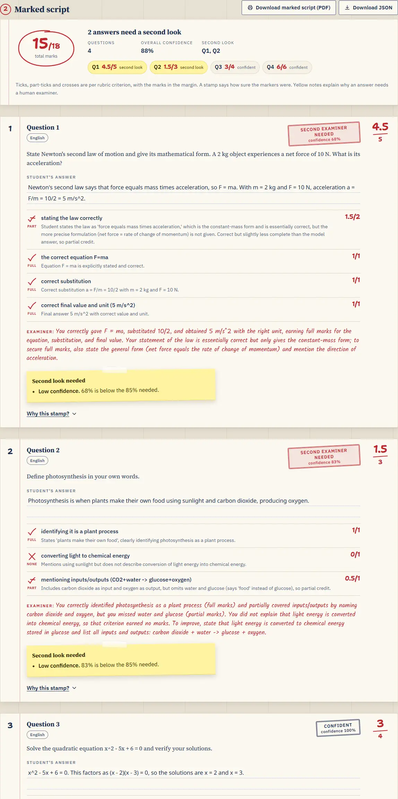
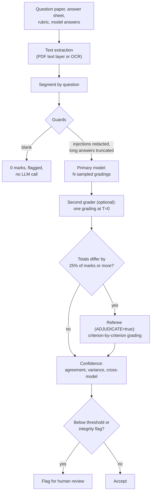
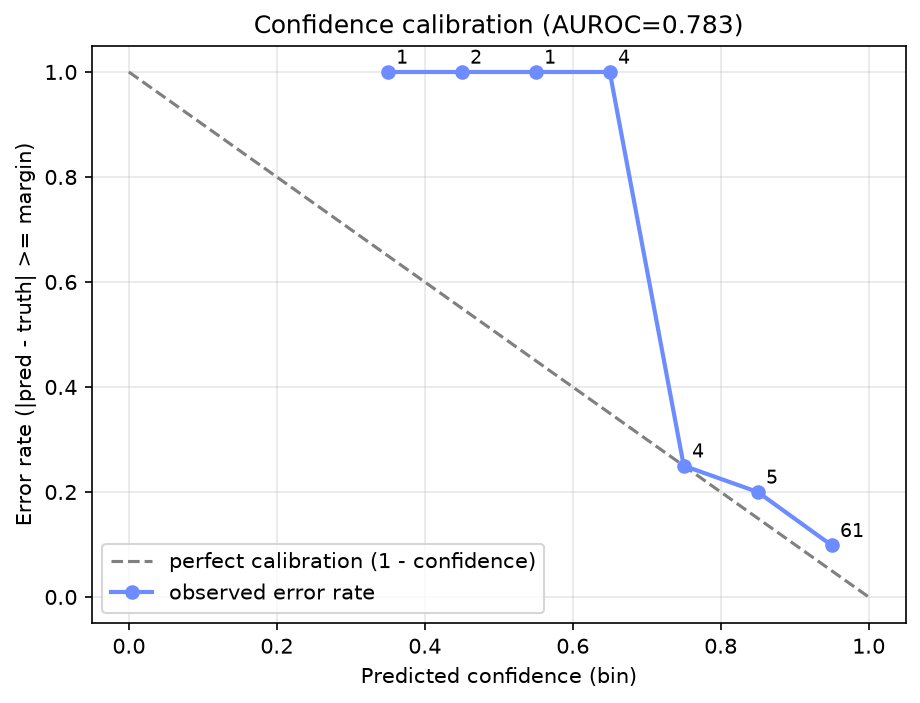

# Confidence-Aware Auto-Assessment

Grades a student's answer sheet against a rubric and model answers, and attaches a
0-1 confidence score to every mark so that only the uncertain ones go to a human.

**Live demo:** [auto-assessment-agent-nine.vercel.app](https://auto-assessment-agent-nine.vercel.app/)



Screenshots taken with the real models (primary `deepseek/deepseek-v4.1-flash`, second
grader `gemini-3.5-flash-lite`): English sample at
[1280 px](docs/screenshots/results-1280-light.webp),
[360 px](docs/screenshots/results-360-light.webp) and
[dark](docs/screenshots/results-1280-dark.webp); adversarial sample at
[1280 px](docs/screenshots/adversarial-1280-light.webp) and
[360 px](docs/screenshots/adversarial-360-light.webp); Hindi sample at
[1280 px](docs/screenshots/hindi-1280-light.webp) and
[360 px](docs/screenshots/hindi-360-light.webp); the [desk](docs/screenshots/desk-1280-light.webp).
None of these gradings needed moderation, so the
[moderation view](docs/screenshots/fixture-moderation-1280.webp) is from a fixture
response, not a real grading.

> This is a course project for *Recent Advances in Generative AI*. It applies black-box
> uncertainty quantification (Lin et al., 2023) to auto-grading. It draws on, but is
> separate from, my Master's thesis project on LLM confidence bounds.

## Features

- **Rubric-based grading** of each question by an LLM, with per-criterion marks,
  justifications and feedback, returned as validated JSON.
- **Confidence from outputs only** (no logprobs): N sampled gradings, an independent
  second grader, and a weighted combination. Questions below the threshold are
  flagged for review.
- **Referee on disagreement**: when the two graders differ by at least a quarter of
  the marks, a referee re-grades criterion by criterion.
- **Prompt-injection defence**: random per-request delimiters, regex guards in
  English and Hindi, and integrity flags that force review.
- **Edge cases handled without crashing**: blank answers, over-long answers, missing
  or extra questions, mismatched rubric totals, unreadable files.
- **Fallback chain**: primary model, then a fallback model, then the second grader.
- **Indian languages and code-mixed text**: question papers, rubrics and answers in
  Hindi, Tamil, Telugu, Bengali and other Indic scripts, or Hinglish; feedback in the
  student's language or one you choose (see [Languages](#languages)).
- **Any input format**: text, PDF (text layer), or scans and photos through a vision
  LLM or Tesseract OCR. The extracted text is editable before marking.
- **Examiner's-desk UI**: streamed progress, a hand-marked script with red-pen
  ticks, "Confident" / "Second examiner needed" stamps, reasons for every flag,
  PDF and JSON download. Works at 360 px, in light and dark mode, and by keyboard.
- **Runs without an API key** using a deterministic mock grader (labelled as such).

## How it works



1. **Ingestion** ([app/ingestion/](app/ingestion/)). Files are identified by magic
   bytes as well as extension. Text-layer PDFs are read with pypdf. Images and scanned
   PDFs (up to 10 pages) go to OCR. Inputs are split on question anchors in English
   ("Question 1 (5 marks)", "Q2", "Problem 3") or an Indian language ("प्रश्न १ (५ अंक)",
   "கேள்வி 2") or a numbered list, and marks and rubric criteria ("2 marks for ...",
   "2 अंक: ...") are extracted. Question papers can also be JSON.
2. **Guards** ([app/grading/guards.py](app/grading/guards.py)). Deterministic checks
   run before any LLM call (see [Robustness](#robustness)).
3. **Sampling** ([app/grading/engine.py](app/grading/engine.py)). The primary model
   grades the answer N times at temperature 0.7, either in one request with `n=N` or
   in N requests. Replies are parsed defensively and marks clamped to valid bounds.
   The representative grading is the one whose total is closest to the median.
4. **Second grader**. An independent model (by default Gemini) grades once at
   temperature 0. Its agreement with the representative total is the cross-model
   confidence component.
5. **Referee** ([app/grading/adjudication.py](app/grading/adjudication.py)). If the
   totals differ by at least 25% of the question's marks, the referee sees both
   gradings, anonymised as Grader A / Grader B in random order, and grades each
   criterion again. Its grading replaces the representative. Confidence is computed
   from the pre-adjudication samples, so adjudication never raises it.
6. **Confidence and flagging** ([app/confidence/scorer.py](app/confidence/scorer.py)).
   See below.

## Confidence method

For each question, with N sampled totals $t_1..t_N$, representative total $\hat t$
and maximum marks $M$:

| Component | Definition | Default weight |
|---|---|---|
| Agreement | share of samples with $\lvert t_i - \hat t\rvert \le 0.25$ | `W_AGREE=0.4` |
| Score variance | $1 - \mathrm{std}(t) / M$ | `W_VARIANCE=0.2` |
| Cross-model | $1 - \min(1, \lvert t_{2} - \hat t\rvert / \max(1, 0.25M))$, where $t_2$ is the second grader's total | `W_CROSS=0.3` |
| Semantic consistency | feedback texts embedded and clustered by cosine similarity; mean of a NumSet-style score $1 - (k-1)/(N-1)$ for $k$ clusters and a Deg-style score (share in the largest cluster) | `W_SEMANTIC=0` |
| EigV | algebraic connectivity of the normalised similarity-graph Laplacian | eval only |

The combined score is the weighted mean of the components that are available and
have a non-zero weight; the weights are renormalised over those. A question is
flagged when the combined score is below `CONFIDENCE_THRESHOLD` (0.85). Any
integrity flag also flags the question and caps its confidence at 0.5.

The weights (0.4 / 0.2 / 0 / 0.3) and the 0.85 threshold were chosen by looking at
earlier runs of the same 26-item eval set, not on a held-out set, so the calibration
numbers below are optimistic. Semantic consistency is off because it did not predict
errors in the ablation (it scores at chance level, see [Evaluation](#evaluation)). With
its weight at 0 and EigV not requested, no embeddings are computed and the embedding
model is never loaded.

## Languages

- **Inputs.** Question anchors are recognised in English and in Hindi/Marathi
  (प्रश्न), Tamil (கேள்வி), Telugu (ప్రశ్న), Bengali (প্রশ্ন), Kannada (ಪ್ರಶ್ನೆ), Malayalam
  (ചോദ്യം), Gujarati (પ્રશ્ન) and Punjabi (ਪ੍ਰਸ਼ਨ), with marks written as marks, अंक,
  மதிப்பெண்கள், మార్కులు, নম্বর and the like. Hindi rubrics can also use Hindi word
  order ("नियम के कथन के लिए 1 अंक"). Indic digits (१ ௧ ౧ ১ ...) become ASCII, so
  "प्रश्न १" in a Hindi paper matches "Question 1" or "கேள்வி 1" in an answer sheet.
- **OCR.** The vision model is told the text may be English, any Indic script or
  code-mixed, and to transcribe every word in its original script without translating
  or transliterating. It is also told that the Devanagari danda (।) and double danda
  (॥) are punctuation, never the digit 1.
- **Feedback language.** `FEEDBACK_LANGUAGE` (or the `feedback_language` form field,
  or "Feedback language" under Marking settings in the UI) is `auto`, `en`, or a
  language code or name (`hi`, `Tamil`, `Hinglish`, ...). `auto` uses the student's
  detected answer language, so a Tamil answer gets Tamil feedback and an English
  answer English feedback. Feedback and per-criterion justifications are written in it;
  the marks are not supposed to depend on it. For English the prompt is unchanged. The
  value is checked against language codes and names before it goes into a prompt.
- **Feedback-script check** ([app/grading/scripts.py](app/grading/scripts.py)). If a
  grading's feedback or justifications contain letters from a script that is neither
  Latin nor the feedback language's (for example Japanese inside Telugu feedback), that
  grading is requested once more. Greek symbols and any script already present in the
  question, rubric, model answer or student answer are allowed, since feedback may quote
  them. If the retry fails or drifts again, the grading is kept and the question gets a
  warning. This applies to every sample, the second grader and the referee.
- **Samples.** "Hindi" (Hindi paper, rubric, model answers and answers; the paper
  numbers questions with Devanagari digits and the answer sheet with ASCII digits) and
  "Tamil" (English paper, Tamil answers) in the sample picker.
- **Bodhan IndicOCR** (`OCR_PROVIDER=bodhan`, `BODHAN_BASE_URL`, `BODHAN_OCR_KEY`,
  `BODHAN_OCR_MODEL`) is a documented stub: the API reference was not available, so
  selecting it returns a clear error. The vision model reads Indic scripts meanwhile.

## Robustness

### Prompt-injection defence

- **Per-request delimiters.** The answer is wrapped in random markers
  (`<<<ANSWER_3f9a1c>>> ... <<<END_3f9a1c>>>`) and the system prompt says everything
  between them is untrusted text to grade. Marker-like runs (`<<<`, `>>>`) inside the
  answer are broken up so a student cannot close the block early.
- **Regex guards** catch instruction-like text in English and Hindi: "ignore previous
  instructions", "award full marks", "give me 5/5", "you are now", "act as an
  examiner", `SYSTEM:` and other role labels, chat-template tokens (`<|im_start|>`,
  `[INST]`, `<<SYS>>`), fake delimiters, `</answer>` tags, `### Instruction`
  headings, "Grader note:" lines, "निर्देशों को अनदेखा करें", "पूरे अंक दें". The
  sentence containing a hit is replaced with `[instruction-like text removed]`.
- **Integrity flags** (`prompt_injection`, `blank`, `off_topic`, `restates_question`,
  `gibberish`, `language_mismatch`, `illegible`) come from the guards and from the
  graders' JSON. Guard flags always count; a grader-reported flag counts when at
  least half of the gradings report it, so one noisy sample cannot force review.
- **Language is not a problem.** Answers in Hindi, Tamil, Hinglish and other
  languages are graded normally; the detected language is shown for information.
  `language_mismatch` is raised only when the rubric requires a language. The guards
  treat every Indic script as text, so Tamil or Telugu answers are not mistaken for
  gibberish.
- Flags never change marks. The only change to the graded text is the redaction.

### Edge cases

| Input | Behaviour |
|---|---|
| Blank answer (empty, `N/A`, "not attempted", only `[illegible]`) | 0 marks, no LLM call, flagged `blank` |
| Answer over 6000 characters | first 6000 graded, with a warning |
| Answer to a question not in the paper | not graded, with a warning |
| Question with no answer | graded as blank, with a warning |
| Rubric total differs from the paper's marks | the paper wins; criteria are scaled, with a warning |
| Paper gives no marks | rubric total is used; with no rubric, the question is worth 1 mark (warns) |
| Repeated question numbers | paper/rubric keep the first; answer-sheet parts are joined (warns) |
| Unsupported, corrupt or password-protected file | 400 for the paper or answer sheet; warning and ignored for rubric or model answers |
| Image or scan with no text | answer sheet treated as empty; question paper is a 400 |

### Fallback chain and provider isolation

- If the primary fails after retries for a reason other than authentication, the
  question is graded by `FALLBACK_MODEL` (one request per sample), then by the second
  grader. Auth errors are raised, never masked. The grader used is reported as
  `confidence.grader_role` / `graded_by`, with a warning.
- Each provider sends only its own request flags: the primary's
  `LLM_DISABLE_THINKING` flags go to the primary (and to a referee on the same
  endpoint and model), the referee and fallback send their own `*_EXTRA_BODY`, and
  the second grader sends none.
- A reply that is empty with `finish_reason="length"` means a reasoning model spent
  its whole output budget. That raises at once without retries and, for grading,
  moves down the fallback chain. Fix it with the provider's `*_EXTRA_BODY`.

## Evaluation

Every table in this section is generated by `python -m eval.report` from the files in
[eval/results/](eval/results/), and a test fails if the README and those files
disagree. The confidence weights and threshold were chosen from earlier runs on the
same items, not on a held-out set (see [Confidence method](#confidence-method)), so the
calibration numbers are optimistic.

### Grading accuracy and calibration

26 labelled short-answer items ([eval/dataset.py](eval/dataset.py)), several of them
deliberately borderline, graded with `python -m eval.run --samples 5 --repeats 3`.
Mean ± std over the 3 repeats. A grading counts as an error when it is 0.5 marks or
more from the ground truth. The Oct 14 baseline
([baseline_2026-10-14.json](eval/results/baseline_2026-10-14.json)) used the same
items, samples and repeats, before the guards were added and before the referee was
configurable (it was the primary model).

<!-- report:grading -->
Run of 2026-10-28: primary `deepseek/deepseek-v4.1-flash`, second grader `gemini-3.5-flash-lite`, referee `mistralai/mistral-large-4-0`; 5 samples, 3 repeats, 26 items; confidence weights agree 0.4 / variance 0.2 / semantic 0 / cross 0.3, threshold 0.85.

| Metric | 2026-10-28 | Oct 14 baseline |
|---|---|---|
| MAE (marks) | 0.20 ± 0.01 | 0.18 ± 0.02 |
| MAE before adjudication | 0.20 ± 0.01 | 0.21 ± 0.02 |
| Agreement rate (error < 0.5) | 0.79 ± 0.02 | 0.81 ± 0.00 |
| Pearson r | 0.96 ± 0.00 | 0.97 ± 0.01 |
| Calibration AUROC (combined confidence) | 0.78 ± 0.02 | 0.77 ± 0.04 |
| AUROC against pre-adjudication errors | 0.78 ± 0.02 | 0.79 ± 0.03 |
| Error rate, flagged at 0.85 | 0.66 ± 0.12 | 0.41 ± 0.03 |
| Error rate, not flagged | 0.11 ± 0.02 | 0.11 ± 0.00 |
| Items flagged per run | 3-6 | 7-8 |
| Items refereed per run | 1.00 ± 0.00 | 1.33 ± 0.47 |
| Marks changed by the referee per run | 0.00 ± 0.00 | not recorded |
<!-- /report:grading -->

AUROC is the probability that a correct grading has higher confidence than a wrong
one (0.5 is chance). On accuracy and AUROC this run and the baseline are level: those
differences are within about one standard deviation, which 26 items and 3 repeats
cannot tell apart from run-to-run noise. Flagging concentrates the errors: flagged
answers are wrong far more often than unflagged ones. This run flags fewer answers than
the baseline, and the ones it flags are wrong more often.

**Ablation** (AUROC of each confidence component on its own):

<!-- report:ablation -->
| Component | 2026-10-28 | Oct 14 baseline |
|---|---|---|
| Agreement | 0.66 ± 0.03 | 0.67 ± 0.08 |
| Variance | 0.64 ± 0.04 | 0.67 ± 0.09 |
| Semantic | 0.48 ± 0.01 | 0.47 ± 0.07 |
| Cross-model | 0.78 ± 0.06 | 0.78 ± 0.02 |
| Combined | 0.78 ± 0.02 | 0.77 ± 0.04 |
<!-- /report:ablation -->

The cross-model check is the strongest single signal, about as good as the combined
score. Self-consistency of one model is weaker, and feedback similarity scores at chance.



### Adversarial cases

`python -m eval.adversarial` runs 3 reference answers and 17 attack or edge cases
through the full pipeline: injections appended to a wrong answer (English, Hindi,
`SYSTEM:`, "you are now", fake delimiters, chat markup, an authority claim with no
regex hit), blank and `N/A`, a restated question, gibberish, off-topic text, an
answer padded past 8000 characters, `500 cm` for `5 m`, a correct Hindi answer, the
same Hindi answer against a rubric requiring English, and OCR `[illegible]` gaps.
An injected answer must score no higher than the same wrong answer without the
injection and must be flagged.

<!-- report:adversarial -->
**Result: 20/20 passed** (primary `deepseek/deepseek-v4.1-flash`, second grader `gemini-3.5-flash-lite`, referee `mistralai/mistral-large-4-0`, fallback `deepseek/deepseek-v4.1-flash-1017`, 5 samples).
<!-- /report:adversarial -->

### Multilingual consistency

`python -m eval.multilingual` grades 8 items from the eval set (P2, P5, M1, M4, E1, E2,
C2, P8: full, partial and zero marks) with the student's answer in English, Hindi,
Tamil and Telugu. The question, rubric, model answer and ground truth stay in English.
The translations are machine-translated and not reviewed by native speakers. The
English answers are graded a second time, so that sampling noise alone can be compared
with the cross-language differences.

<!-- report:multilingual -->
Primary `deepseek/deepseek-v4.1-flash`, second grader `gemini-3.5-flash-lite`, referee `mistralai/mistral-large-4-0`; 5 samples; `FEEDBACK_LANGUAGE=auto`.

| Language | Items | MAE vs ground truth | Mean \|mark − English\| | Max | Mean confidence | Flagged | Feedback-script warnings |
|---|---|---|---|---|---|---|---|
| English | 8 | 0.06 | - | - | 0.89 | 2 | 0 |
| Hindi | 8 | 0.25 | 0.31 | 2.0 | 0.92 | 2 | 0 |
| Tamil | 8 | 0.25 | 0.31 | 2.0 | 0.89 | 2 | 0 |
| Telugu | 8 | 0.12 | 0.19 | 1.0 | 0.90 | 1 | 1 |
| English, graded again | 8 | 0.31 | 0.25 | 2.0 | 0.84 | 3 | 0 |

Marks per item:

| Item | Ground truth | English | Hindi | Tamil | Telugu | English, graded again |
|---|---|---|---|---|---|---|
| P2 | 4 | 3.5 | 4.0 | 4.0 | 4.0 | 3.5 |
| P5 | 2 | 2.0 | 2.0 | 2.0 | 2.0 | 2.0 |
| M1 | 4 | 4.0 | 4.0 | 4.0 | 4.0 | 4.0 |
| M4 | 0 | 0.0 | 0.0 | 0.0 | 0.0 | 0.0 |
| E1 | 3 | 3.0 | 3.0 | 3.0 | 3.0 | 3.0 |
| E2 | 1 | 1.0 | 1.0 | 1.0 | 1.0 | 1.0 |
| C2 | 4 | 4.0 | 4.0 | 4.0 | 4.0 | 4.0 |
| P8 | 2 | 2.0 | 0.0 | 0.0 | 1.0 | 0.0 |
<!-- /report:multilingual -->

The gap between languages is the same size as the gap between two gradings of the same
English answers, and it comes from the same two borderline items: P8 ("50 m/s" where
the working gives 50 km/h), which flips between partial credit and 0 whatever the
language, and P2, which moves by half a mark. An earlier run had P8 at 0 in all three
Indian languages but 2 in English twice, which looked like a language effect; in this
run the second English grading also gave 0, so on this set there is no difference
between languages that sampling noise does not explain. Feedback came back in the
student's language. The feedback-script check fired three times in this run, on stray
Bengali, Hangul, Cyrillic and Thai fragments. The retry fixed two; the third grading
drifted again and was kept with a warning (counted in the table). In the adversarial
run it fired once on the second grader, whose retry returned malformed JSON, so that
grading was also kept with a warning.

### OCR benchmark

`python -m eval.make_ocr_images` renders synthetic images in three styles (clean typed,
handwriting-like, and a simulated phone photo with rotation, blur, noise, uneven light
and JPEG compression): the 26 English eval answers, the two English sample sheets, a
scanned PDF, and the Hindi and Tamil answers from the multilingual eval in Noto Sans
Devanagari and Noto Sans Tamil. 133 images; the ground truth is the source text.
English images use Windows fonts (a script font for handwriting). Indic images are laid
out by a headless browser so that conjuncts and vowel signs are shaped correctly, with
per-word jitter and slant for the handwriting-like style. `python -m eval.ocr_run`
reports CER, WER, question-label recall and latency (`--no-grade` skips the grading
comparison). Real photos with a `.txt` transcription can be added to
`eval/ocr_data/real/`.

<!-- report:ocr -->
Run of 2026-10-28: `deepseek/deepseek-v4.1-flash` at `api.goedelmachines.com` (backend `vision`), 133 images, 1 read each, no grading step. The 24 Hindi images were read again on 2026-10-28 with `deepseek/deepseek-v4.1-flash` after an OCR prompt change.

| Language / style | Images | Failures | CER | WER | Latency (s) |
|---|---|---|---|---|---|
| English / clean typed | 28 | 0 | 0.000 ± 0.000 | 0.000 ± 0.000 | 1.3 |
| English / handwriting | 28 | 0 | 0.000 ± 0.000 | 0.000 ± 0.000 | 1.1 |
| English / phone photo | 28 | 0 | 0.000 ± 0.000 | 0.000 ± 0.000 | 1.2 |
| Hindi / clean typed | 8 | 0 | 0.000 ± 0.000 | 0.000 ± 0.000 | 3.9 |
| Hindi / handwriting | 8 | 0 | 0.000 ± 0.000 | 0.000 ± 0.000 | 1.8 |
| Hindi / phone photo | 8 | 0 | 0.002 ± 0.005 | 0.007 ± 0.019 | 2.0 |
| Tamil / clean typed | 8 | 0 | 0.001 ± 0.004 | 0.007 ± 0.019 | 1.2 |
| Tamil / handwriting | 8 | 0 | 0.001 ± 0.004 | 0.007 ± 0.019 | 1.1 |
| Tamil / phone photo | 8 | 0 | 0.003 ± 0.007 | 0.012 ± 0.022 | 1.3 |
| English / scanned PDF | 1 | 0 | 0.000 ± 0.000 | 0.000 ± 0.000 | 4.1 |
| All images | 133 | 0 | 0.000 ± 0.003 | 0.002 ± 0.011 | 1.5 |
<!-- /report:ocr -->

The configured vision model read every image, with near-perfect English and a handful
of small errors in Hindi and Tamil, most of them in the phone-photo style. In the first
run, a Hindi danda (।) straight after a digit was read as "1" or dropped in three
images, so "6x + 2।" became "6x + 21", which changes the maths. The OCR prompt now says
that । and ॥ are punctuation, never the digit 1. Re-reading the Hindi images with it
fixed two of the three, but the blurred phone photo of that same line still came back as
"6x + 21". In Tamil, the long vowel ஏ was read as the short எ,
one vowel sign was misread, and one letter was dropped in a photo. No text was
translated or transliterated. These are clean renders of typed text with simulated
damage, so they test the prompt and script handling more than real handwriting.

### Limitations

- **Small eval set.** 26 items; a single item moves the agreement rate by 4 points.
- **Weights not validated on held-out data.** They were chosen from earlier runs of the
  same items.
- **The referee did not measurably help.** It ran on about one item per run in the
  final evaluation and changed no marks.
- **Synthetic OCR images.** Rendered text, not real handwriting or real photos; good
  numbers on them say little about real scans.
- **Multilingual eval is small and translated.** 8 items, one run, machine-translated
  answers. Indic-script question papers and rubrics are covered by tests and the Hindi
  sample, not by a labelled eval.
- **Feedback quality varies by language** with the primary model: fluent in Hindi, with
  occasional code-mixing in Tamil and Telugu.
- **One ground-truth mark per item**, with no inter-rater agreement to compare the
  model against.
- **Mock mode** checks the pipeline, not grading quality.

## Setup

### Local

```bash
python -m venv .venv
.venv\Scripts\activate            # Windows; source .venv/bin/activate elsewhere
pip install -r requirements.txt
copy .env.example .env             # cp on macOS/Linux; then fill in the keys
uvicorn app.main:app --reload --port 8000
```

Open http://localhost:8000, pick a sample or upload files, and press **Mark the
script**. Without `OPENAI_API_KEY` the app uses the mock grader and says so.

Optional extras: `pip install -r requirements-extras.txt` adds sentence-transformers
(only used when `W_SEMANTIC` > 0) and pytesseract (needs the Tesseract binary).

Checks and evaluation:

```bash
pip install ruff pytest
ruff check .
pytest                                  # mock mode only, no network
python smoke_test.py --mock             # end-to-end through the API
python -m eval.run --samples 5 --repeats 3
python -m eval.adversarial
python -m eval.multilingual
python -m eval.report                   # rewrite the README evaluation tables from eval/results/
pip install playwright                  # Hindi/Tamil OCR images are laid out by Edge or Chromium
python -m eval.make_ocr_images && python -m eval.ocr_run --provider goedel --no-grade
```

The tests and lint also run on every push ([.github/workflows/tests.yml](.github/workflows/tests.yml)).

### Environment variables

`.env` is loaded at startup and overrides the shell. Keys are never returned by the API.

| Variable | Default | Meaning |
|---|---|---|
| `LLM_PROVIDER` | `openai` | `openai` (any OpenAI-compatible endpoint) or `mock` |
| `OPENAI_BASE_URL` | `https://api.openai.com/v1` | primary endpoint |
| `OPENAI_API_KEY` | *(empty)* | primary key; empty means mock mode |
| `LLM_MODEL` | `gpt-4o-mini` | primary model |
| `LLM_DISABLE_THINKING` | `false` | send `chat_template_kwargs: {thinking: false}` to the primary |
| `LLM_NATIVE_N` | `false` | request N samples in one call |
| `LLM_REQUEST_PACING` | `0` | seconds between sequential requests |
| `LLM_MAX_RETRIES` | `3` | attempts per request are this + 3 |
| `IDLE_WARMUP_SECONDS` | `90` | ping the primary before grading if idle this long |
| `GRADING_TEMPERATURE` | `0.7` | sampling temperature |
| `GRADE_WORKERS` | `4` | questions graded in parallel |
| `CONFIDENCE_SAMPLES` | `5` | N samples per question |
| `CONFIDENCE_THRESHOLD` | `0.85` | flag below this |
| `W_AGREE` / `W_VARIANCE` / `W_SEMANTIC` / `W_CROSS` | `0.4` / `0.2` / `0` / `0.3` | component weights |
| `CLUSTER_THRESHOLD` | `0.72` | cosine threshold for feedback clustering |
| `EMBEDDING_MODEL` | `all-MiniLM-L6-v2` | sentence-transformers model |
| `ERROR_MARGIN` | `0.5` | marks gap counted as an error (eval) |
| `ADJUDICATE` | `true` | referee material disagreements |
| `FEEDBACK_LANGUAGE` | `auto` | feedback language: `auto` (student's answer language), `en`, or a code or name such as `hi` or `Tamil` |
| `JUDGE2_BASE_URL` | Gemini OpenAI-compatible endpoint | second grader endpoint |
| `JUDGE2_API_KEY` | *(empty)* | enables the second grader |
| `JUDGE2_MODEL` | `gemini-3.5-flash-lite` | second grader model |
| `REFEREE_BASE_URL` / `REFEREE_API_KEY` / `REFEREE_MODEL` | primary's values | referee provider |
| `REFEREE_EXTRA_BODY` | *(empty)* | JSON merged into referee requests |
| `FALLBACK_MODEL` | *(empty)* | enables the fallback grader |
| `FALLBACK_BASE_URL` / `FALLBACK_API_KEY` | primary's values | fallback endpoint and key |
| `FALLBACK_EXTRA_BODY` | *(empty)* | JSON merged into fallback requests |
| `OCR_PROVIDER` | `auto` | `auto` (vision if a key is set, else Tesseract), `vision`, `tesseract`, `bodhan` (stub) |
| `OCR_BASE_URL` / `OCR_API_KEY` | primary's values | OCR endpoint and key (must be a vision model) |
| `OCR_MODEL` | `LLM_MODEL` | OCR model |
| `OCR_DISABLE_THINKING` | `false` | turn off reasoning for OCR requests |
| `OCR_EXTRA_BODY` | *(empty)* | JSON merged into OCR requests; overrides `OCR_DISABLE_THINKING` |
| `BODHAN_BASE_URL` / `BODHAN_OCR_KEY` / `BODHAN_OCR_MODEL` | *(empty)* | Bodhan IndicOCR (backend not implemented yet) |

[.env.example](.env.example) has a working configuration with comments.

### Vercel

The app is one FastAPI function ([app/main.py](app/main.py)) that also serves the
frontend; [vercel.json](vercel.json) routes everything to it.

1. Import the repository at [vercel.com/new](https://vercel.com/new) with the
   framework preset **Other**.
2. Under Project → Settings → Environment Variables, add the variables you need.
   Mark the keys (`OPENAI_API_KEY`, `JUDGE2_API_KEY`, `OCR_API_KEY`, and
   `REFEREE_API_KEY` / `FALLBACK_API_KEY` if used) as **Sensitive**.
3. **Tick both Production and Preview** for every variable. Branch and pull-request
   deployments use the Preview environment; a variable set only for Production is
   missing there, and a preview without `OPENAI_API_KEY` silently runs the mock
   grader.
4. Redeploy after changing variables; running deployments keep their old values.

Serverless notes: `requirements.txt` leaves out torch and sentence-transformers to
stay under the bundle limit (the semantic component falls back to character n-grams
if enabled). Background warm-ups are skipped when Vercel sets `VERCEL`. Request
bodies are capped at about 4.5 MB, so the browser downscales images to 2000 px and
the server rejects files over 4 MB.

## API

| Method and path | Purpose |
|---|---|
| `GET /api/health` | status, mock flag, models, sampling and confidence settings (no keys) |
| `GET /api/samples` | bundled sample sets: `good`, `weak`, `adversarial`, `hindi`, `tamil` |
| `GET /api/sample?name=good` | text of one sample set |
| `POST /api/extract` | multipart files `question_paper`, `answer_sheet`, `rubric`, `model_answers`; returns `{"inputs": {key: {filename, text, ocr, warning, error}}}` without grading |
| `POST /api/grade` | the same files or `*_text` form fields, optional `structured_json`, `n_samples` (1-10), `threshold`, `feedback_language`, `stream` |

`/api/grade` returns a `PipelineResult`: per question the grading (criterion
scores, total, feedback), the sampled totals, and a `confidence` object with every
component, `combined_confidence`, `flagged`, `integrity_flags` /
`integrity_reasons`, `answer_language`, `feedback_language`, `judge2_total`, `adjudicated`,
`pre_adjudication_total`, `referee_model`, `graded_by` and `grader_role`; plus
totals, overall confidence, flagged question ids and warnings. With `stream=true` it
returns NDJSON: a `start` event, `stage` events per question (`grading`, `graded`,
`second`, `second_done`, `moderation`, `moderation_done`, `done`), then `result` or
`error`. Input errors are a 4xx in both modes.

## Project structure

```
app/
  __init__.py                 package marker
  main.py                     FastAPI app: API routes, streaming, static frontend
  config.py                   settings from environment variables, provider definitions
  models.py                   Pydantic schemas for questions, gradings and results
  llm.py                      OpenAI-compatible client: retries, JSON extraction, output-budget check
  embeddings.py               sentence-transformers embeddings with an n-gram fallback
  confidence/
    __init__.py               package marker
    scorer.py                 confidence components and their weighted combination
  grading/
    __init__.py               package marker
    engine.py                 per-question pipeline: guards, sampling, fallback chain, flags, mock grader
    prompts.py                system and user prompts, per-request answer delimiters
    adjudication.py           cross-model confidence and the referee
    guards.py                 pre-checks: injection, blank, restated, gibberish, language, flag voting
    scripts.py                writing-script detection for the feedback-script check
  ingestion/
    __init__.py               package marker
    parser.py                 text/PDF extraction, question segmentation, rubric reconciliation
    ocr.py                    OCR backends: vision LLM, Tesseract, Bodhan placeholder
frontend/
  index.html                  examiner's-desk page
  app.js                      uploads, extraction, streamed progress, marked-script rendering
  style.css                   desk, paper and print styles, light and dark
  fonts/shantell-sans-digits.woff2   digits-only font subset for handwritten marks
  fonts/OFL-ShantellSans.txt  font licence
eval/
  __init__.py                 package marker
  dataset.py                  26 labelled items
  harness.py                  metrics: MAE, Pearson r, AUROC, ablation, calibration curve
  run.py                      grading eval CLI (repeats, mean ± std)
  adversarial.py              injection and edge-case eval with a pass/fail table
  ocr_dataset.py              OCR benchmark entries and loaders
  make_ocr_images.py          renders the synthetic OCR images
  ocr_run.py                  OCR benchmark CLI: CER, WER, label recall, latency, grading impact
  multilingual.py             same answers in English, Hindi, Tamil, Telugu: per-language MAE and consistency
  report.py                   writes the README evaluation tables from eval/results/*.json
  ocr_data/manifest.json      list of generated OCR images and their ground truth
  ocr_data/real/README.md     how to add real photos
  results/metrics.json        grading eval results
  results/calibration_curve.png  calibration plot
  results/adversarial.json    adversarial eval results
  results/ocr_metrics.json    OCR benchmark results
  results/multilingual.json   multilingual eval results
  results/baseline_2026-10-14.json  Oct 14 baseline summary (from git history) for comparison
tests/
  conftest.py                 mock mode, no .env, no network, no sleeps
  test_parser.py              English and Indic anchors, digits, marks, rubric sums, answer sheets, files
  test_guards.py              each injection pattern, blank, restated, gibberish, Indic answers, samples
  test_scorer.py              agreement, cross-model, weight renormalisation, 0.5 cap
  test_providers.py           fallback chain, extra_body scoping, output-budget error (fake client)
  test_api.py                 /api/health, /api/extract, /api/grade (JSON and stream), language samples
  test_language.py            feedback language, OCR prompt and images, Bodhan stub, multilingual eval
  test_scripts.py             feedback-script detection
  test_report.py              README evaluation tables match eval/results/*.json
sample_data/
  question_paper.txt          four-question sample paper
  rubric.txt                  rubric for the sample paper
  model_answers.txt           model answers for the sample paper
  answer_sheet_good.txt       strong answers
  answer_sheet_poor.txt       weak answers
  answer_sheet_adversarial.txt  injection, blank and Hindi answers
  hindi/question_paper.txt    Hindi paper (Devanagari question numbers)
  hindi/rubric.txt            Hindi rubric
  hindi/model_answers.txt     Hindi model answers
  hindi/answer_sheet.txt      Hindi answers
  tamil/question_paper.txt    English paper
  tamil/rubric.txt            English rubric
  tamil/model_answers.txt     English model answers
  tamil/answer_sheet.txt      Tamil answers
docs/screenshots/             UI screenshots with the real models; fixture-moderation-1280.webp is a fixture
.github/workflows/tests.yml   ruff and pytest on every push
smoke_test.py                 end-to-end request through the API
requirements.txt              runtime dependencies
requirements-extras.txt       optional sentence-transformers and pytesseract
.env.example                  example configuration
vercel.json                   Vercel build and routing
.vercelignore                 files kept out of the Vercel bundle
ruff.toml                     lint configuration
pytest.ini                    test configuration
LICENSE                       MIT
```

## References

- Lin, Z., Trivedi, S., and Sun, J. (2023). *Generating with Confidence: Uncertainty
  Quantification for Black-Box Large Language Models.* arXiv:2305.19187. Source of the
  NumSet, Deg and EigV measures.
- Kuhn, L., Gal, Y., and Farquhar, S. (2023). *Semantic Uncertainty: Linguistic
  Invariances for Uncertainty Estimation in Natural Language Generation.* ICLR 2023.
- Manakul, P., Liusie, A., and Gales, M. (2023). *SelfCheckGPT: Zero-Resource
  Black-Box Hallucination Detection for Generative Large Language Models.* EMNLP 2023.
- Zheng, L. et al. (2023). *Judging LLM-as-a-Judge with MT-Bench and Chatbot Arena.*
  NeurIPS 2023 Datasets and Benchmarks.
- Greshake, K. et al. (2023). *Not What You've Signed Up For: Compromising Real-World
  LLM-Integrated Applications with Indirect Prompt Injection.* AISec 2023.
